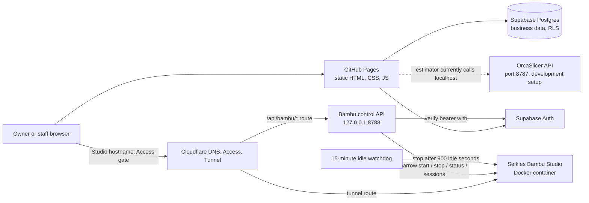

# PinoyProto 3D system overview

**Purpose:** a reference map for the owner and future coding agents. Read this before changing connected services or server behavior.

**Last reviewed:** 2026-11-18 (Asia/Manila)  
**Scope:** repository inventory and architecture. Current account-specific security findings belong in the local-only, git-ignored `docs/private/SYSTEM_AUDIT.md` when present. Do not copy that file into public pages, commits, or messages to third parties.

## At a glance



## Component inventory

| Component | Responsibility | Where to inspect |
|---|---|---|
| `index.html` | Main tools workspace, navigation, shared admin sign-in | `index.html` |
| `tools/*.html` | Dashboard, customer tracker, feedback renderer, quotation tools, Bambu Studio status/power screen | `tools/` |
| `assets/` | Shared site CSS, JS, fonts, images, and templates | `assets/` |
| GitHub Pages workflow | Publishes the static website on pushes to `main` or manual dispatch | `.github/workflows/deploy-pages.yml`; artifact is staged from `index.html`, `assets/`, and `tools/` only |
| Supabase Auth | Website sign-in and session handling | Browser-side integration in the website; server validation in `server/bambu-control/main.py` |
| Supabase Postgres | Business quotations, trackers, projects, payments, memberships, and audit events | Database schema and policy changes are under `supabase/migrations/` |
| Cloudflare DNS / Access / Tunnel | Public Studio hostname, Access sign-in, tunnel to local services | Live account state can change; inspect Cloudflare before relying on a past scan |
| Bambu Studio desktop | Browser-streamed Linux desktop in Docker | `server/bambu-studio/`; deployed topology must be checked on Proxmox |
| Bambu control API | Admin-only status, session list, start, and stop actions | `server/bambu-control/` |
| Idle watchdog | Detects active desktop connections and stops only Docker after 15 idle minutes | `server/bambu-control/pinoyproto-bambu-idle-watchdog*` |
| OrcaSlicer API | Headless model slicing for estimator time/material metadata | `server/main.py` and `server/README.md` |

## Public hostname and tunnel map

Cloudflare live state and Supabase live state are intentionally kept out of this generally shareable overview. Check the local-only audit file for the latest scan and its verification date. Never record account tokens, passwords, private keys, user email lists, or database rows in either file.

## Request and data flows

### Website login and business tools

1. Browser loads the static GitHub Pages site.
2. Frontend uses Supabase Auth for the signed-in session.
3. Business tools read/write Postgres tables through the Supabase client; RLS is the database authorization layer.
4. Roles in the local migrations are `owner`, `admin`, `operator`, and `viewer`. Intended policy: members read, operators create, owners/admins update/delete sensitive business records.

### Bambu Studio remote desktop and controls

1. Browser opens `studio.pinoyproto3d.stream` in a separate tab.
2. Cloudflare Access authenticates that route.
3. Cloudflare Tunnel sends desktop traffic to the local Studio origin on port 3001.
4. Website status/power calls go to `/api/bambu/*`; the tunnel forwards those to the local control API on port 8788.
5. The API verifies the Supabase bearer session with Supabase Auth, then enforces a server-side admin email allowlist.
6. API invokes a fixed root-owned wrapper using `sudo -n`; allowed wrapper actions are `status`, `watch`, `sessions`, `start`, and `stop` for the `bambu-studio` container only.
7. The sessions helper queries Selkies `/api/sessions`. The website can display connection count, connected-since, transport/role/display, RTT, and watchdog countdown. It does not obtain a client MAC address from this route.
8. The idle watchdog samples established TCP connections to port 3001 every 30 seconds. With no active connection for 900 seconds, it gracefully stops Docker container `bambu-studio`; it does not stop LXC 101 or Proxmox.

### Price Estimator / OrcaSlicer

The local backend accepts `POST /api/slice` and `GET /health` on port 8787. It shells out to the OrcaSlicer CLI and extracts generated G-code metadata. The repository README says the estimator calls `http://localhost:8787/api/slice`; that means remote users need their own local service or a deliberate authenticated remote deployment. Do not silently expose this API publicly: model uploads and resource usage need authentication, limits, and a deployment design first.

## Security principles

- Supabase RLS and role checks must protect business tables. Permissive PostgreSQL policies combine with OR semantics; always inspect all existing policies, expressions, and grants before altering access.
- The Bambu control API must verify a valid Supabase bearer session and a server-side admin allowlist.
- Keep the root-owned Bambu command wrapper limited to the named Docker container; do not give the website API general shell or Proxmox credentials.
- Keep Cloudflare Access in front of the remote desktop. Do not publish the direct desktop port through router port forwarding.
- Keep credentials in environment/configuration stores on the host, not in browser code, source control, or deployment artifacts.
- The GitHub Pages artifact must include only `index.html`, `assets/`, and `tools/`.

## Proxmox / LXC state

Proxmox cannot be verified from this repository. Use the read-only collector at `server/diagnostics/proxmox-readonly-audit.sh` on the host and record any fresh status only in the local-only audit file. Do not mistake a running LXC for a running Docker application.

The collector avoids printing environment variables, credentials, tunnel tokens, and container configuration secrets:

```bash
bash /root/proxmox-readonly-audit.sh
```

Copy `server/diagnostics/proxmox-readonly-audit.sh` from this repository to `/root/proxmox-readonly-audit.sh` on Proxmox first. Review its output for local addresses before sharing it outside your private chat.

## Repository map

```text
index.html                         Website shell and central admin sign-in
tools/                             Independent static tool pages
assets/css, assets/js, assets/...  Shared design system and website assets
server/main.py                     OrcaSlicer FastAPI backend
server/bambu-control/              Bambu status/session/start/stop API and watchdog
server/bambu-studio/               Example Compose config and setup notes
supabase/migrations/               Business schema, role/RLS model, hardening migrations
.github/workflows/deploy-pages.yml GitHub Pages publication boundary
.cursor/rules/                     Repo-persistent Cursor guidance
.cursor/skills/                    Site-specific implementation skills
AGENTS.md                           Repo instructions for AI coding agents
docs/SYSTEM_OVERVIEW.md             This architecture and audit reference
```

## Operational checklist

### Normal Bambu Studio usage

1. Sign into the website admin account.
2. Check the Bambu Studio status and current desktop connections in the Bambu Studio page.
3. Start the Studio Docker app if stopped; open its Cloudflare-protected hostname in a separate tab.
4. When finished, stop it manually or let the 15-minute disconnected-desktop watchdog stop only that Docker app.

### If the public Studio hostname fails

1. Check the Cloudflare tunnel status and active connector.
2. On LXC 101, check `docker ps` for `cloudflared` and `bambu-studio`.
3. Confirm the intended origin ports are listening: 3001 for the desktop and 8788 for the control API.
4. Check Cloudflare Access login/policy if the tunnel is healthy but auth denies access.
5. Do not expose port 3001 or 8788 on the public router as a workaround.

### Before database policy changes

1. Review existing live policies and table grants, not just migration file names.
2. Remove old permissive policies explicitly in a new reviewed migration.
3. Verify anon cannot read or write customer data and verify each authenticated role's intended actions.
4. Run Supabase security/performance/health advisors.
5. Record whether the migration was applied to production; the current API reports no migrations, while the live schema contains newer tables/columns, so migration tracking needs reconciliation.

## Keep this map current

When infrastructure changes, update this document with stable architectural facts and update the local-only audit with live state/findings. Add a verification date and say how the fact was checked. Do not add credentials, personal identifiers, database rows, or unneeded private network details.
